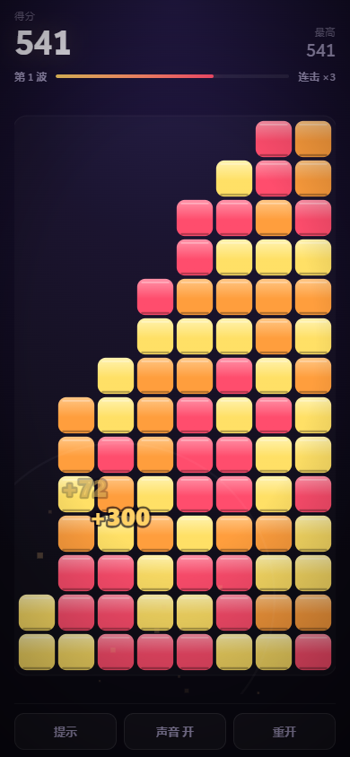

# 碎 · SHATTER

点掉同色的整团，看它们塌下来。单指可玩的消除小游戏，一个 HTML 文件，没有依赖，离线可玩。



## 玩法

棋盘上是 8 列彩色石块。**点任意一块，和它相邻的同色整团一起炸掉**，上面的石块顺势塌下来。连得越快，连击倍率越高。

- 得分 = `(团的大小 − 1)² × 连击倍率`
- **连击窗口 1.5 秒**：在这之内接着消，倍率 +1（最高 ×9），HUD 上那条烧红的条就是剩余时间
- 每次消除会按音阶升调发声，连击越高音越高——连得顺的时候你其实在弹一段旋律
- 把整盘消光会有一次大奖励（`500 × 波次`）
- 消到没有可消的团，进入下一波：颜色更多、团更小、连击更难接上
- 最高分存在本地，关掉再打开还在

**没有生命值，也不会失败。** 这是刻意的，理由写在下面的开发笔记里。

## 在手机上玩

打开链接就能玩，不用装任何东西。想更像个 App：

- **iOS Safari**：分享 → 添加到主屏幕
- **Android Chrome**：菜单 → 添加到主屏幕

加完之后是全屏、无地址栏、断网也能开（有 service worker 缓存）。

## 本地跑

需要一个 HTTP 服务（service worker 和 manifest 在 `file://` 下不工作）：

```bash
python -m http.server 8765 --directory .
# 然后浏览器打开 http://127.0.0.1:8765
```

手机上试：手机和电脑连同一个 Wi-Fi，打开 `http://<电脑的局域网IP>:8765`。

## 部署到 GitHub Pages

静态文件，不需要构建。推到 GitHub 之后：

**Settings → Pages → Source 选 `Deploy from a branch` → 分支选 `main`、目录选 `/ (root)` → Save**

一两分钟后网址是 `https://<用户名>.github.io/<仓库名>/`。仓库里已经有 `.nojekyll`，跳过 Jekyll 处理。

## 技术

- **单个 `index.html`**，零依赖、无构建步骤；改完刷新即可
- Canvas 渲染，棋盘按可用宽高比**反推行数**（10~14 行），手机竖屏能同时吃满宽和高，不留死区
- 触摸用 Pointer/Touch 事件，禁掉双击缩放和下拉刷新，适配刘海屏安全区
- 音效用 WebAudio 现场合成，没有任何音频文件
- PWA：`manifest.webmanifest` + `sw.js`，可安装、可离线
- 图标是用 Node 内置 `zlib` 手写 PNG 编码生成的（`tools/make-icons.mjs`），也不引第三方库
- 支持 `prefers-reduced-motion`：会关掉碎屑和屏幕震动

## 开发笔记：为什么删掉了生命值和目标

第一版是有"每波目标分数 + 三颗心"的。写完我做了个自动求解器，在真实的手机视口里跑了几百盘来量难度曲线，结果推翻了这套设计：

| 波次 | 目标 | 得分中位 | 得分/目标 |
|---|---|---|---|
| 1 | 160 | 708 | 4.42× |
| 5 | 457 | 522 | 1.14× |
| 9 | 1305 | 897 | 0.69× |
| 12 | 2867 | 1221 | 0.43× |

目标按 `1.30^波次` 指数增长，实际得分却是平的甚至往下走（颜色从 3 加到 6，团变小，`(n−1)²` 骤降）。两条曲线方向相反，必然崩：前期毫无难度，后期不可能通过。

改成"目标 = 这一盘自身潜力的某个比例"之后公平了，但**配对测量**（同一块棋盘上跑三种解法）揭示了更根本的问题：

| 波次 | 认真玩/目标 | 会玩/目标 | 乱点/目标 |
|---|---|---|---|
| 1 | 1.93× | 1.86× | 1.94× |
| 8 | 1.39× | 1.15× | 1.24× |
| 14 | 1.28× | 1.15× | 1.18× |

纯随机乱点的得分和贪心解几乎一样。因为只要一直点、点到没有可消的团为止，总分基本由棋盘本身决定，跟操作顺序关系不大。我又去量了"剩余块数"（能不能把棋盘清干净），结论一样——三种解法剩余块数的中位数只差 0~1 块。

也就是说，这套机制撑不起一个真实的难度系统。硬要加，只会做出玩家莫名其妙就输、或者永远输不了的**假难度**。所以我把生命值和目标整个删了，把真正的技术点——**1.5 秒连击窗口下的速度**——做成核心，并且明确不做失败条件。这是个靠手感爽感和连击速度取胜的休闲游戏，那就照这个做，不装。

## 测试

需要 Python 和 Playwright，以及一个跑在 8765 端口的本地服务。

```bash
python tools/play_test.py     # 手机视口下的完整交互验证（含截图）
python tools/balance.py       # 配对测量三种解法的难度曲线
python tools/readme_shot.py   # 重新生成 README 截图
node   tools/make-icons.mjs   # 重新生成 PWA 图标
```

`play_test.py` 覆盖：加载无报错、棋盘尺寸与布局、真实触摸消除、连击累加与过期、提示、静音开关、换波、连续推 5 波、重开、service worker 注册、最高分跨会话保留。调试接口挂在 `?dev=1` 后面，正常玩到的版本里没有。

## 许可

MIT
